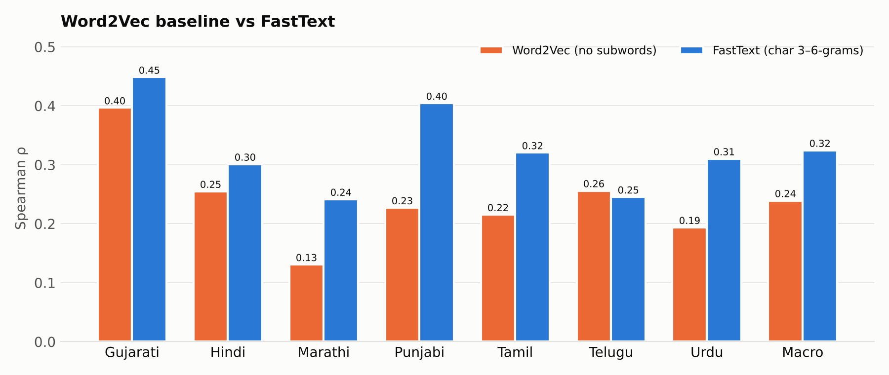
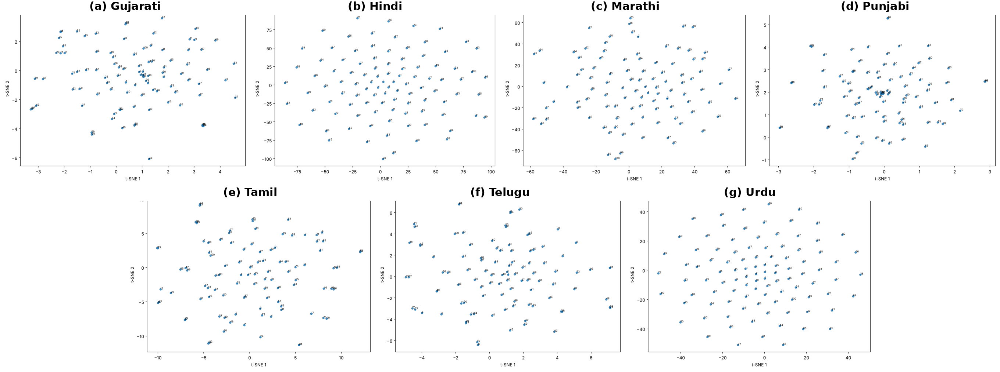

# IndicWordVec — Multilingual Word Embeddings for 7 Indian Languages

> 300-dimensional FastText embeddings trained from scratch on IndicCorpV2 and evaluated against human similarity judgements for Gujarati, Hindi, Marathi, Punjabi, Tamil, Telugu and Urdu, with full OOV coverage and bit-for-bit reproducible results.


**Headline result:** macro-average Spearman **ρ = 0.3244** across all seven languages (0.3275 ± 0.0060 over three random seeds), every language significant at p < 0.05, **83.9 % vocabulary coverage**, and **zero dropped word pairs**.

* 📄 Report: [`docs/report/Experimental_Report.pdf`](docs/report/Experimental_Report.pdf) (IEEE format, LaTeX source in [`docs/report/latex/`](docs/report/latex/))
* 📓 Notebook: [`FOVL_Word_Embeddings_G25AIT2138.ipynb`](FOVL_Word_Embeddings_G25AIT2138.ipynb) (executed, with all outputs)
* 📦 Submission package: [`FOVL_Word_Embeddings_Submission.zip`](FOVL_Word_Embeddings_Submission.zip)

---

## Overview

Indian languages are morphologically rich, written in several scripts, and under-resourced, so many benchmark words never appear in a small training corpus. This project trains **one monolingual FastText Skip-gram model per language, from random initialisation, using only IndicCorpV2-5k** (5,000 records per language), and evaluates it on the word-similarity datasets of Akhtar et al. (2017).

* **OOV robustness.** Pairs with unseen words may not be discarded. Unseen words are composed from learned character 3–6-grams; a blank or degenerate input falls back to the frequency-weighted mean vocabulary vector, so every input gets a finite, non-zero 300-d vector.
* **Data integrity.** The benchmark has mixed delimiters, byte-order marks, 149 Marathi rows without a score and one blank Tamil word. Every row is kept in its original order in the exported arrays; defective rows are excluded only from the correlation.
* **Exact reproducibility.** Training is single-threaded with a fixed CRC-32 hash in place of Python's randomised `hash()`, so re-running the notebook reproduces every reported number exactly.

---

## Results

### Public benchmark

| Language | Pairs (N) | Scored | Spearman ρ | p-value | Coverage | OOV rate |
|---|--:|--:|--:|--:|--:|--:|
| Gujarati | 163 | 163 | **0.4484** | <0.0001 | 89.6 % | 10.4 % |
| Punjabi | 143 | 143 | **0.4043** | <0.0001 | 89.3 % | 10.7 % |
| Tamil | 97 | 96 | **0.3204** | 0.0015 | 82.4 % | 17.6 % |
| Urdu | 100 | 100 | **0.3101** | 0.0017 | 82.9 % | 17.1 % |
| Hindi | 235 | 235 | **0.3009** | <0.0001 | 87.7 % | 12.3 % |
| Telugu | 111 | 111 | **0.2453** | 0.0095 | 72.5 % | 27.5 % |
| Marathi | 253 | 104 | **0.2414** | 0.0136 | 79.8 % | 20.2 % |
| **Macro / total** | **1,102** | **952** | **0.3244** | — | **83.9 %** | **16.1 %** |

Rows are excluded from ρ only where the benchmark has no human score (Marathi: 149 rows) or a blank word (Tamil: 1 row); all 1,102 pairs are embedded and exported.


Coverage tracks quality closely in this setting: the rank correlation between coverage and ρ across languages is **0.82**. The two highest-coverage languages (Gujarati, Punjabi) are the two best; the two lowest (Telugu, Marathi) are the two weakest.

### Experiments (all seven languages)

**Ablation** — one setting changed at a time:

| Experiment | Macro ρ | Change |
|---|--:|--:|
| E1 main (3–6-grams, 25 epochs, min_count 1) | **0.3244** | — |
| E2 char n-grams 2–5 | 0.2677 | -0.0567 |
| E3 15 epochs | 0.2846 | -0.0398 |
| E4 min_count 2 | 0.3067 | -0.0177 |


**Word2Vec baseline** (same settings, no subwords): macro ρ **0.2392** vs **0.3244** for FastText (+0.0852). Subwords help in six of seven languages, most in Punjabi, Urdu, Marathi and Tamil.



**Seed robustness** — seeds 1, 7, 42: macro ρ **0.3275 ± 0.0060**.

### t-SNE (100 words per language)



---

## Method

| Setting | Value | Setting | Value |
|---|---|---|---|
| Model | FastText Skip-gram | Vector size | **300** |
| Char n-grams | 3–6 | n-gram buckets | 2,000,000 |
| Window | 5 | Negative samples | 5 |
| min_count | 1 | Subsampling | 1e-3 |
| Epochs | 25 | Learning rate | 0.025 |
| Seed | 42 | Workers | 1 (deterministic) |

Preprocessing: Unicode NFC, whitespace tokenisation, punctuation (including the danda) stripped from each token. The same normalisation is applied to benchmark words.

---

## Quick start

### Google Colab

1. Open `FOVL_Word_Embeddings_G25AIT2138.ipynb` in [Google Colab](https://colab.research.google.com).
2. **Runtime → Run all.** The notebook downloads IndicCorpV2-5k and the benchmark itself. Main training takes about 10 minutes; the experiments in section 10 take about an hour (each group can be switched off).
3. Section 12 builds the submission ZIP after you upload the executed notebook and the report PDF.

### Local

```bash
git clone https://github.com/g25ait2138-collab/word-embeddings-nlp.git
```

```bash
cd word-embeddings-nlp && pip install -r requirements.txt
```

```bash
jupyter notebook FOVL_Word_Embeddings_G25AIT2138.ipynb
```

Each trained model needs about 2.5 GB of RAM while loaded; the inference functions keep one model in memory at a time.

### Embedding arbitrary words (including OOV)

```python
v = get_word_vector('विद्यालयों', 'Hindi')            # (300,)
E = embed_words(['வங்கி', 'பணம்'], 'ta')              # (2, 300)
A = embed_pairs([('बाघ', 'चिड़ियाघर')], 'hi')          # (1, 2, 300)
s = predict_similarity([('बाघ', 'चिड़ियाघर')], 'hi')   # cosine similarities
```

Languages can be given as a name (`'Hindi'`) or code (`'hi'`). If a model file is missing, it is retrained deterministically from IndicCorpV2.

---

## Submission package

`FOVL_Word_Embeddings_Submission.zip` contains:

| Path | Content |
|---|---|
| `embeddings/<Language>.npy` | float32 array of shape `(N, 2, 300)`, original pair order |
| `vocabulary/<Language>_vocab.json` | every benchmark word → its `[row, column]` positions, with in-vocabulary/OOV status |
| `tables/` | per-language results, coverage/OOV statistics, per-pair predictions, word-pair analysis, experiments |
| `figures/` | t-SNE plots and ID-to-word mappings |
| `FOVL_Word_Embeddings_G25AIT2138.ipynb` | executed notebook |
| `Experimental_Report.pdf` | report |

The trained FastText models (about 2.4 GB each, because of the two million n-gram buckets) are not included; the notebook regenerates them deterministically.

---

## Repository structure

```
word-embeddings-nlp/
├── FOVL_Word_Embeddings_G25AIT2138.ipynb   # complete pipeline, executed
├── FOVL_Word_Embeddings_Submission.zip     # submission package
├── Word-Similarity-Datasets-for-Indian-Languages-master.zip   # benchmark (evaluation only)
├── requirements.txt
├── LICENSE
└── docs/
    ├── images/        # figures used in this README
    └── report/
        ├── Experimental_Report.pdf
        └── latex/     # LaTeX source and figures of the report
```

---

## Disclosure

All embeddings are trained from scratch on **IndicCorpV2-5k only**. No pre-trained models or embeddings and no external training corpora are used, and the benchmark's human similarity scores are used only to compute the reported correlations. Tools: Python, Gensim (FastText, Word2Vec), NumPy, SciPy, pandas, Matplotlib, scikit-learn.

## References

1. Bojanowski, P., Grave, E., Joulin, A., & Mikolov, T. (2017). *Enriching Word Vectors with Subword Information.* TACL, 5, 135–146.
2. Mikolov, T., Chen, K., Corrado, G., & Dean, J. (2013). *Efficient Estimation of Word Representations in Vector Space.* arXiv:1301.3781.
3. Akhtar, S. S., Gupta, A., Vajpayee, A., Srivastava, A., & Shrivastava, M. (2017). *Word Similarity Datasets for Indian Languages: Annotation and Baseline Systems.* LAW XI.
4. Doddapaneni, S., et al. (2023). *Towards Leaving No Indic Language Behind: Building Monolingual Corpora, Benchmark and Models for Indic Languages.* ACL.
5. van der Maaten, L., & Hinton, G. (2008). *Visualizing Data using t-SNE.* JMLR, 9.
6. Řehůřek, R., & Sojka, P. (2010). *Software Framework for Topic Modelling with Large Corpora* (Gensim).

## License

MIT — see [LICENSE](LICENSE). IndicCorpV2-5k ([`rony000013/indiccorpV2-5k`](https://huggingface.co/datasets/rony000013/indiccorpV2-5k)) and the benchmark ([Akhtar et al.](https://github.com/syedsarfarazakhtar/Word-Similarity-Datasets-for-Indian-Languages)) keep their own licenses.

---

**Author:** Alok Sahni (G25AIT2138) · [GitHub](https://github.com/g25ait2138-collab) · aloksahni04@gmail.com · Foundations of Vision and Language, PGDAI, IIT Jodhpur
