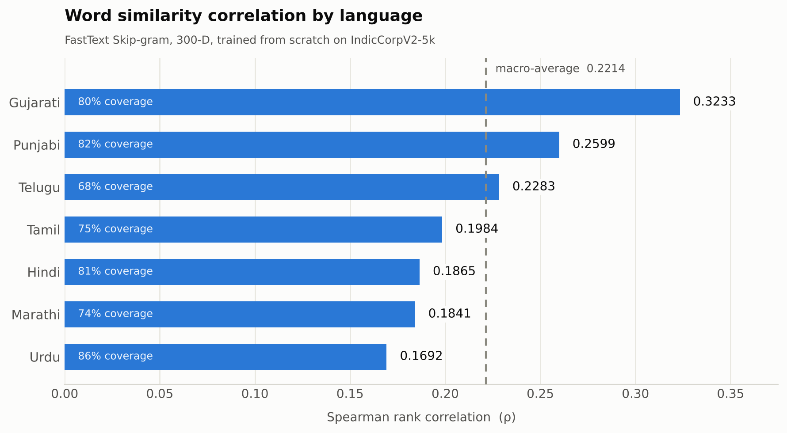
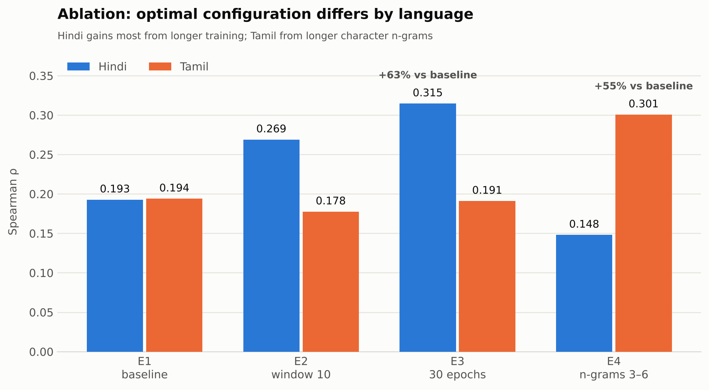
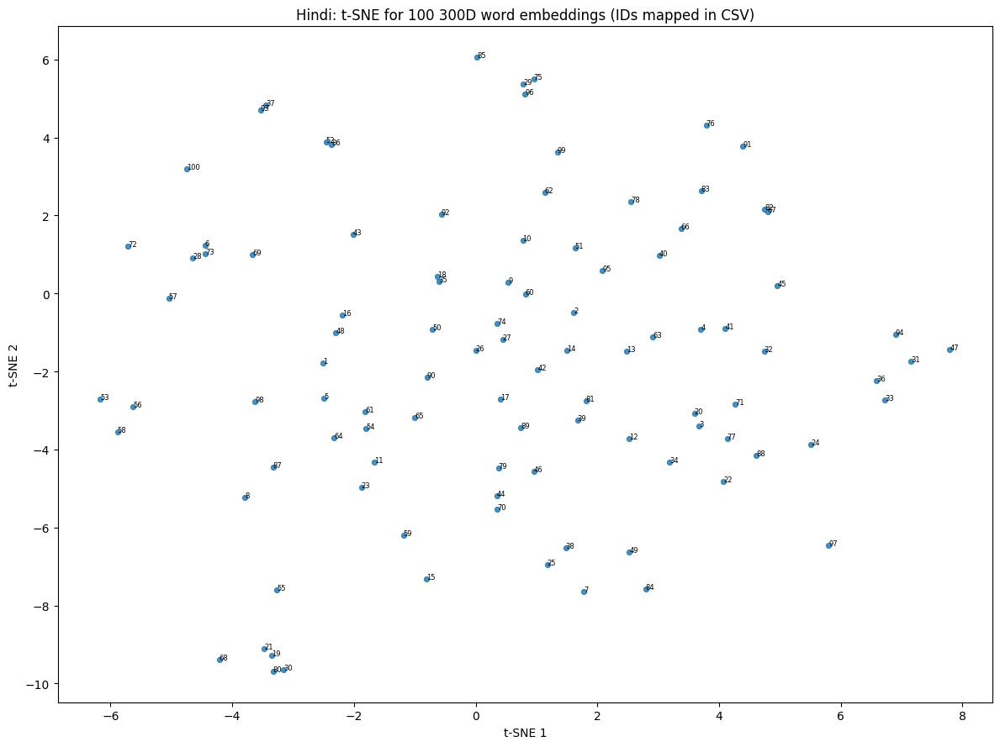
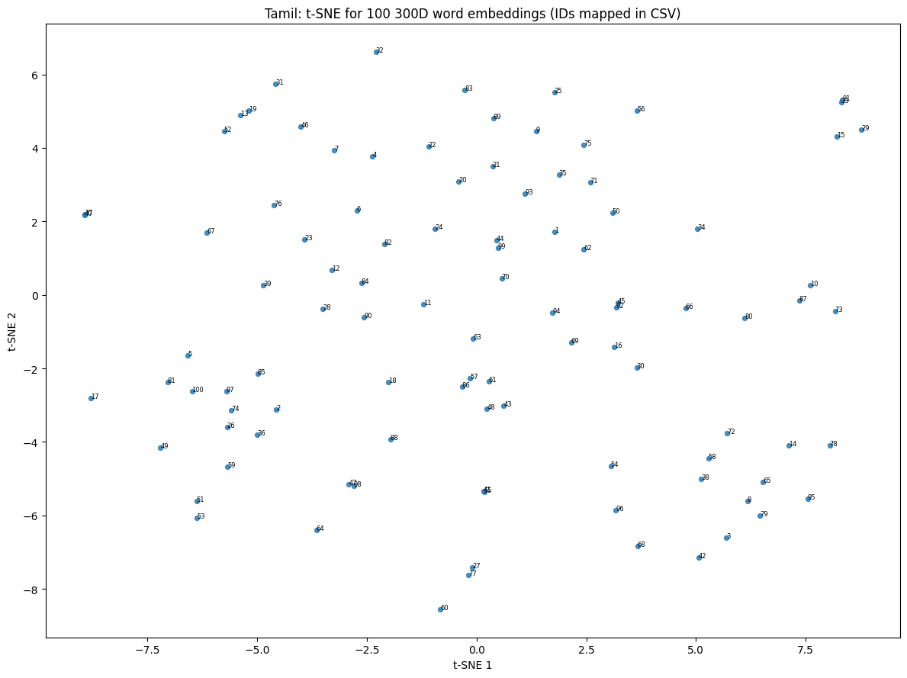

# IndicWordVec — Multilingual Word Embeddings for 7 Indian Languages

> Training 300-dimensional FastText embeddings from scratch on IndicCorpV2 and evaluating them against human similarity judgments across Gujarati, Hindi, Marathi, Punjabi, Tamil, Telugu, and Urdu — with full OOV coverage and reproducible, assertion-validated artifacts.


---

## Overview

Most NLP tooling assumes English. Indian languages are morphologically rich, written in seven different scripts, and badly under-resourced — which means a word form seen in a test set often never appears in the training corpus at all.

This project builds **monolingual word embedding models for seven Indian languages entirely from scratch**, with no pre-trained vectors and no external corpora, then evaluates them intrinsically against the human-annotated word similarity benchmark of Akhtar et al. (2017).

The engineering focus is on three things that matter more than a leaderboard number:

1. **Out-of-vocabulary robustness.** Discarding OOV word pairs is not permitted, so every word — including unseen inflections and malformed strings — must resolve to a meaningful 300-dimensional vector. This is handled with FastText character n-grams plus a frequency-weighted corpus-mean fallback.
2. **Data integrity over convenience.** The public benchmark contains real defects: mixed delimiters, 149 rows with missing human scores, a blank word field, UTF-8 BOMs. The pipeline preserves every row in its original order and excludes defects only from the correlation statistic — it never silently repairs or drops data.
3. **Verifiable reproducibility.** A fixed seed, a fast smoke test, and a strict final validator that refuses to produce a submission package unless every array shape, dtype, finiteness check, and word-pair ordering constraint passes.

**Headline result:** macro-average Spearman **ρ = 0.2190** across all seven languages, with **67.5–86.3 % vocabulary coverage** and **zero dropped word pairs**.

---

## Key Features

- **Seven monolingual FastText Skip-gram models**, trained from random initialization at exactly 300 dimensions.
- **Subword-based OOV inference** — any arbitrary input string, seen or unseen, returns a finite, non-degenerate vector.
- **Script-agnostic Unicode pipeline** — NFC normalization and a `\p{L}\p{M}\p{N}` regex tokenizer that handles Devanagari, Gujarati, Gurmukhi, Tamil, Telugu, and Perso-Arabic scripts under one code path, applied identically at train and eval time.
- **Defect-tolerant benchmark loader** — per-line delimiter sniffing, BOM stripping, NaN-safe score parsing, zero row loss.
- **Full intrinsic evaluation suite** — cosine similarity, Spearman ρ with p-values, and per-language vocabulary coverage / OOV rate statistics.
- **Rank-based error diagnostics** — word pairs are compared on *rank* agreement rather than raw score deltas, surfacing the model's best and worst predictions as interpretable examples.
- **Controlled ablation harness** — parameterized experiments over context window, epoch budget, and n-gram range.
- **t-SNE visualization** of 100 vectors per language, with ID-to-word CSV mappings that remain readable even when the host system lacks Indic fonts.
- **Clean inference API** — `embed_words`, `embed_pairs`, `predict_similarity` with model caching, usable for blind private-test evaluation without retraining.
- **Fail-fast validation and packaging** — a final gate that enumerates every missing or malformed artifact instead of shipping a broken ZIP.

---

## Results

### Public benchmark — all seven languages

| Language | Pairs (N) | Scored | Spearman ρ | p-value | Coverage | OOV rate |
|----------|----------:|-------:|-----------:|--------:|---------:|---------:|
| Gujarati | 163 | 163 | **0.3084** | 0.00006 | 79.6 % | 20.4 % |
| Punjabi  | 143 | 143 | **0.2540** | 0.0022  | 82.5 % | 17.5 % |
| Telugu   | 111 | 111 | **0.2258** | 0.0172  | 67.5 % | 32.5 % |
| Urdu     | 100 | 100 | **0.2125** | 0.0337  | 86.3 % | 13.7 % |
| Hindi    | 235 | 235 | **0.1901** | 0.0034  | 80.8 % | 19.2 % |
| Tamil    |  97 |  96 | **0.1846** | 0.0718  | 75.0 % | 25.0 % |
| Marathi  | 253 | 104 | **0.1571** | 0.1111  | 74.2 % | 25.8 % |
| **Macro-average** | **1,102** | **952** | **0.2190** | — | **78.0 %** | **22.0 %** |

Every one of the 1,102 benchmark pairs is represented in the exported embedding arrays. Rows with missing human scores or blank word fields are retained in the arrays and excluded only from the correlation computation.

### Ablation study (Hindi / Tamil)

| Experiment | Window | Epochs | n-grams | Hindi ρ | Tamil ρ |
|------------|-------:|-------:|--------:|--------:|--------:|
| E1 — baseline | 5 | 15 | 2–5 | 0.1982 | 0.1988 |
| E2 — wider window | 10 | 15 | 2–5 | 0.2654 | 0.1847 |
| E3 — longer training | 5 | 30 | 2–5 | **0.3181** | 0.1401 |
| E4 — larger n-grams | 5 | 15 | 3–6 | 0.1564 | **0.2891** |

**Finding:** no single configuration wins across languages. Hindi gains **+61 %** from doubling the epoch budget — the same change costs Tamil **30 %** — while Tamil, far more agglutinative, gains **+45 %** from longer character n-grams, which gives Hindi its worst result. This is direct evidence that hyperparameters for Indic NLP must be tuned per-language rather than inherited from English defaults.

---

## Tech Stack

| Layer | Tools |
|-------|-------|
| **Language** | Python 3.10+ |
| **Embeddings / NLP** | Gensim (FastText Skip-gram), `regex` (Unicode property classes), `unicodedata` |
| **Data** | Hugging Face `datasets`, pandas, NumPy |
| **Evaluation** | SciPy (`spearmanr`, `rankdata`) |
| **Dimensionality reduction** | scikit-learn (t-SNE) |
| **Visualization** | Matplotlib |
| **Environment** | Google Colab / Jupyter, `pathlib`, `zipfile` |

**Keywords:** NLP · Word Embeddings · FastText · Word2Vec · Skip-gram · Subword Models · Multilingual NLP · Low-Resource Languages · Indic NLP · Unicode Normalization · Tokenization · Intrinsic Evaluation · Spearman Rank Correlation · Cosine Similarity · OOV Handling · t-SNE · Hyperparameter Ablation · Reproducible ML · Hugging Face Datasets · Gensim · NumPy · SciPy

---

## System Architecture

```
┌─────────────────────────────────────────────────────────────────┐
│  1. DATA INGESTION                                              │
│     IndicCorpV2-5k (HF Datasets) ──► 118,243 documents          │
│     Schema introspection ──► language-code resolution           │
│     ──► 5,000 documents × 7 languages                           │
└────────────────────────────┬────────────────────────────────────┘
                             ▼
┌─────────────────────────────────────────────────────────────────┐
│  2. PREPROCESSING (shared by train + eval — no drift)           │
│     Unicode NFC normalization ──► casefold                      │
│     ──► \p{L}\p{M}\p{N} tokenizer ──► sentences (len ≥ 2)       │
└────────────────────────────┬────────────────────────────────────┘
                             ▼
┌─────────────────────────────────────────────────────────────────┐
│  3. TRAINING  (×7, independent, from random init)               │
│     FastText Skip-gram | dim=300 | window=5 | neg=10            │
│     char n-grams 2–5 | min_count=2 | epochs=15 | seed=42         │
│     ──► models/{Language}_fasttext.model                        │
└────────────────────────────┬────────────────────────────────────┘
                             ▼
┌─────────────────────────────────────────────────────────────────┐
│  4. VECTOR RESOLUTION (WordVectorResolver)                      │
│     in-vocab ──► learned vector                                 │
│     OOV      ──► character n-gram composition                   │
│     blank / degenerate ──► frequency-weighted corpus mean       │
│     guarantee: finite, non-zero-norm, always 300-D              │
└────────────────────────────┬────────────────────────────────────┘
                             ▼
┌─────────────────────────────────────────────────────────────────┐
│  5. EVALUATION                                                  │
│     Benchmark loader (delimiter sniff, BOM, NaN-safe)           │
│     ──► cosine similarity per pair                              │
│     ──► Spearman ρ (valid rows only) + coverage / OOV stats     │
│     ──► (N, 2, 300) float32 arrays, original order preserved    │
└────────────────────────────┬────────────────────────────────────┘
                             ▼
┌─────────────────────────────────────────────────────────────────┐
│  6. ANALYSIS & ARTIFACTS                                        │
│     t-SNE (100 words × 7) │ rank-error diagnostics │ ablations  │
│     ──► strict validator ──► submission ZIP                     │
└─────────────────────────────────────────────────────────────────┘
```

**Design rule:** the benchmark is evaluation data only. Human similarity scores never touch training, gradients, or model selection — they are read exclusively to compute the reported correlation.

---

## Installation & Setup

### Option A — Google Colab (recommended)

1. Upload `FOVL_Word_Embeddings_G25AIT2138.ipynb` to [Google Colab](https://colab.research.google.com).
2. Upload `Word-Similarity-Datasets-for-Indian-Languages-master.zip` to the Colab **Files** panel.
3. **Runtime → Run all.** Dependencies install in the first cell.

### Option B — Local Jupyter

```bash
# Clone
git clone https://github.com/g25ait2138-collab/Word-Embeddings-NLP.git
cd Word-Embeddings-NLP

# Virtual environment
python -m venv .venv
source .venv/bin/activate        # Windows: .venv\Scripts\activate

# Dependencies (pinned)
pip install -r requirements.txt

# Place the benchmark archive in the project root, then:
jupyter notebook FOVL_Word_Embeddings_G25AIT2138.ipynb
```

### Recommended run order

| Step | Cell section | Purpose | Approx. time |
|------|--------------|---------|--------------|
| 1 | Setup & config | Imports, seeds, output directories | < 1 min |
| 2 | Benchmark import | Extract and validate 7 `*-WS.txt` files | < 1 min |
| 3 | Corpus discovery | Load IndicCorpV2, resolve language codes | 2–4 min |
| 4 | **Smoke test** | 100 docs × 2 epochs — validates the whole path | 2–3 min |
| 5 | Full training | 7 models × 15 epochs + evaluation | 25–45 min |
| 6 | t-SNE + diagnostics | Figures, rank-error analysis | 5–8 min |
| 7 | Ablations | E1–E4 on Hindi and Tamil | 15–25 min |
| 8 | Validate & package | Strict checks, submission ZIP | < 2 min |

> **Always run the smoke test first.** It exercises ingestion, training, OOV inference, and evaluation on a tiny slice, so configuration errors surface in minutes rather than after a 40-minute full run. Smoke-test models are never persisted and its scores are never reported.

### Reproducibility

`SEED = 42` is applied to `random`, `numpy`, Gensim, and t-SNE. Small variations across runs remain possible from Gensim's multi-worker scheduling.

---

## Usage Examples

### Embed a batch of words (OOV-safe)

```python
vectors = embed_words(['विद्यालय', 'छात्र', 'क्ष्यज्ञत्रक'], language='Hindi')
print(vectors.shape)              # (3, 300)
print(np.isfinite(vectors).all()) # True — even for the nonsense third token
```

### Embed word pairs in benchmark order

```python
pairs = [('विद्यालय', 'स्कूल'),       # synonyms
         ('विद्यालयों', 'विद्यालय'),   # inflected form — OOV at training time
         ('क्ष्यज्ञत्रक', 'विद्यालय')]  # malformed string

arrays = embed_pairs(pairs, language='Hindi')
print(arrays.shape)               # (3, 2, 300)
```

### Predict similarity

```python
print(predict_similarity(pairs, language='Hindi'))
# [0.6843  0.8966  0.6239]
```

The inflected OOV form `विद्यालयों` scores **0.897** against its base form `विद्यालय` — the subword model recovers the morphological relationship without ever having seen that surface form.

### Reload a trained model for private evaluation

```python
model = load_language_model('Tamil', models_dir='FOVL_Output/models')
print(model.wv.vector_size)       # 300
```

### Evaluate a single language end-to-end

```python
result, arrays, sims, resolver = evaluate_language('Gujarati', model)
print(f"ρ = {result['Spearman']:.4f} | coverage = {result['Coverage']:.1%}")
# ρ = 0.3084 | coverage = 79.6%
```

---

## Folder Structure

```
Word-Embeddings-NLP/
├── FOVL_Word_Embeddings_G25AIT2138.ipynb      # Complete pipeline (single notebook)
├── README.md
├── LICENSE
├── requirements.txt                           # Pinned dependency versions
├── .gitignore                                 # Excludes FOVL_Output/ build artifacts
├── Word-Similarity-Datasets-for-Indian-Languages-master.zip
├── FOVL_Word_Embeddings_Submission.zip       # Notebook, report, t-SNE figures, result tables (no models/embeddings)
│
├── docs/
│   ├── images/                                # Figures referenced by this README
│   │   ├── results_chart.png                  # Per-language Spearman + coverage
│   │   ├── ablation_chart.png                 # E1–E4 across Hindi and Tamil
│   │   └── tsne_{language}.png                # t-SNE projections (×7)
│   └── report/
│       ├── Experimental_Report.pdf            # Final report (IEEE format, 5 pages)
│       ├── Experimental_Report_Detailed.pdf   # Extended 9-page report
│       ├── Experimental_Report_Detailed.docx  # Editable version of the extended report
│       └── latex/                             # LaTeX source and figures for the IEEE report
│
└── FOVL_Output/                               # Generated at runtime
    ├── benchmark/            # 7 extracted *-WS.txt evaluation files
    ├── models/               # {Language}_fasttext.model  (×7)
    ├── embeddings/           # {Language}.npy  — (N, 2, 300) float32
    ├── vocabulary/           # {Language}_vocab.json — pair order + word→position index
    ├── figures/              # tsne_{Language}.png + ID→word label CSVs
    ├── tables/
    │   ├── language_results.csv              # Per-language ρ, coverage, OOV
    │   ├── training_statistics.csv           # Docs, sentences, vocabulary size
    │   ├── {Language}_pair_predictions.csv   # Every pair: human score vs cosine
    │   ├── word_pair_analysis_10.csv         # Best/worst rank-agreement cases
    │   ├── experiments.csv                   # E1–E4 ablation results
    │   └── results.json                      # Machine-readable summary
    └── Experimental_Report.pdf
```

---

## Challenges & Solutions

| # | Challenge | Solution |
|---|-----------|----------|
| 1 | **OOV words could not be discarded**, yet 13–33 % of benchmark vocabulary never appears in the corpus. | Chose FastText over Word2Vec/GloVe specifically for character n-gram composition, then layered a `WordVectorResolver` with a frequency-weighted corpus-mean fallback for blank or degenerate strings. Guarantees a finite, non-zero-norm 300-D vector for *any* input. |
| 2 | **Benchmark files were inconsistently formatted** — Hindi comma-delimited, the rest tab-delimited, some with UTF-8 BOMs. | Per-line delimiter sniffing with `csv.reader`, and `utf-8-sig` decoding to transparently strip BOMs. |
| 3 | **149 Marathi rows had missing scores and one Tamil row had a blank word** — dropping them would break the required `(N, 2, 300)` shape. | Decoupled the two concerns: *all* rows stay in the exported arrays in original order; a boolean validity mask restricts the Spearman computation to scored, non-blank rows. Row counts and exclusions are reported explicitly rather than hidden. |
| 4 | **Seven scripts, one tokenizer.** Whitespace splitting mangles combining marks; English-centric `\w+` drops Indic diacritics. | A single Unicode-property regex `[\p{L}\p{M}\p{N}]+` over NFC-normalized, casefolded text — applied identically to training and evaluation to eliminate preprocessing drift. |
| 5 | **Dataset schema was not guaranteed** — column names and language codes are undocumented. | Runtime introspection with candidate-name resolution and an alias table (`hi`/`hin`/`hin_deva`/`hindi`). The pipeline raises rather than silently training on the wrong language. |
| 6 | **Colab RAM exhaustion** when holding seven models plus corpora simultaneously. | Streaming per-language train → evaluate → export → `del` + `gc.collect()` cycle; t-SNE reloads each model from disk independently. |
| 7 | **Raw score deltas misled error analysis** (human scores are 1–10, cosine is −1–1). | Switched diagnostics to `scipy.rankdata` and compared *rank* positions, correctly surfacing cases like Hindi `पैसे`/`मुद्रा` (human 8.6, cosine 0.24, rank error 210). |
| 8 | **A broken submission could pass unnoticed.** | A `validate_final()` gate asserting array shape, `float32` dtype, finiteness, non-zero norms, exact pair-order match against the source files, and a live OOV reload test per language — it enumerates every problem and refuses to build the ZIP. |
| 9 | **Fonts for Indic scripts are unavailable in most Matplotlib environments**, rendering t-SNE labels as empty boxes. | Plotted numeric IDs and exported a parallel `id → word → (x, y)` CSV per language, so figures stay interpretable anywhere. |
| 10 | **A `pandas` 3.1.x / Colab incompatibility** crashed `display()` on DataFrames mid-run. | Replaced `display()` with `to_string()` / `to_markdown()`, keeping the notebook executable on current Colab images. |

---

## Skills Demonstrated

**Machine learning & NLP**
- Training distributional semantic models from scratch (FastText Skip-gram, negative sampling)
- Subword/character n-gram representations for morphologically rich, low-resource languages
- Intrinsic evaluation methodology: cosine similarity, Spearman rank correlation, significance testing, macro-averaging
- Dimensionality reduction and embedding-space visualization (t-SNE)
- Controlled hyperparameter ablation with per-language analysis of results

**Data engineering**
- Hugging Face `datasets` ingestion with runtime schema introspection
- Unicode normalization (NFC), multi-script tokenization, encoding/BOM handling
- Defect-tolerant parsing that preserves data integrity instead of silently repairing it
- Memory-constrained batch processing with explicit lifecycle management

**Software engineering practice**
- Separation of concerns: ingestion → preprocessing → training → resolution → evaluation → packaging
- Defensive programming — assertion-driven invariants on shape, dtype, finiteness, and ordering
- A smoke-test tier that validates the full path cheaply before an expensive run
- Reproducibility discipline: seeded randomness, pinned configuration, persisted intermediate artifacts
- A clean inference API designed for blind evaluation by a third party
- Automated validation gating before release

**Communication**
- Technical reporting with evidence-linked claims
- Honest, explicit documentation of limitations and data defects

---

## Future Improvements

- **Per-language hyperparameter search.** The ablations show the optimum differs sharply by language; a proper grid or Bayesian search per language is the single highest-value next step.
- **Scale the corpus.** 5,000 documents per language is a small slice of IndicCorpV2. Coverage and ρ should both improve substantially with more text — vocabulary coverage of 67.5 % (Telugu) is the clearest bottleneck.
- **Benchmark alternative architectures.** Word2Vec CBOW/Skip-gram and GloVe under the identical evaluation harness, to quantify exactly how much the subword component contributes.
- **Script-aware and morphology-aware tokenization.** Integrate IndicNLP tokenizers and test morpheme-level segmentation for agglutinative Tamil and Telugu.
- **Cross-lingual alignment.** Project the seven monolingual spaces into a shared space (Procrustes / VecMap) to enable cross-lingual retrieval.
- **Contextual comparison.** Benchmark against MuRIL or IndicBERT representations to measure the static-embedding ceiling on this task.
- **Extrinsic evaluation.** Validate the embeddings on a downstream task (classification, NER) — intrinsic similarity correlation is a weak proxy for usefulness.
- **Engineering hardening.** Refactor the notebook into an installable package with a CLI, add `pytest` coverage for the loader and resolver, pin dependencies in `requirements.txt`, and wire up CI.

---

## Results & Visualizations

### Per-language Spearman correlation



Gujarati leads at ρ = 0.3084 and Marathi trails at 0.1571. Notably, correlation does **not** track vocabulary coverage — Urdu has the highest coverage (86.3 %) but ranks only fourth, while Telugu has the lowest coverage (67.5 %) yet ranks third, indicating that corpus *quality and domain match* matter more than raw vocabulary hit rate.

### Ablation study



The two languages respond to opposite interventions. Hindi improves 61 % from doubling the epoch budget, which *hurts* Tamil by 30 %; Tamil improves 45 % from longer character n-grams, which gives Hindi its worst result.

### Embedding space — t-SNE projections

100 vocabulary words per language, projected 300-D → 2-D. Points are labelled with numeric IDs rather than the words themselves, because most environments lack fonts for all seven scripts; each figure ships with a `tsne_{Language}_word_labels.csv` mapping IDs back to words and coordinates.

| Hindi | Tamil |
|---|---|
|  |  |

Projections for all seven languages are in [`docs/images/`](docs/images/). The distributions are diffuse rather than tightly clustered — consistent with the modest correlation scores and a 5,000-document-per-language training budget.

> **Optional:** add a short screen recording of the smoke test as `docs/images/pipeline_demo.gif` and reference it here.

---

## Resume-Ready Impact Points

- Trained and evaluated **7 monolingual 300-D FastText embedding models from scratch** across 7 Indian languages and scripts on a **118K-document** corpus, achieving a **0.2190 macro-average Spearman correlation** against human similarity judgments.
- Engineered a **subword + frequency-weighted-fallback OOV strategy** delivering **100 % word-pair coverage** on a benchmark where **13–33 % of vocabulary was unseen**, satisfying a hard no-discard constraint.
- Built a **defect-tolerant Unicode data pipeline** (NFC normalization, multi-script regex tokenization, delimiter sniffing, BOM handling) that preserved all **1,102 benchmark pairs** in original order while isolating 150 malformed rows from the reported statistic.
- Ran a **controlled 4-configuration ablation** that lifted Hindi correlation by **61 %** and Tamil by **45 %**, demonstrating that Indic embedding hyperparameters must be tuned per-language rather than inherited from English defaults.
- Implemented **assertion-driven validation gating** across array shape, dtype, finiteness, and ordering invariants, plus a smoke-test tier that cut configuration-error turnaround from ~40 minutes to ~3.

---

## Contributing

Contributions are welcome — especially additional languages, alternative embedding architectures, or extrinsic evaluation tasks.

1. **Fork** the repository and create a branch: `git checkout -b feature/glove-baseline`
2. **Run the smoke test** before the full pipeline to confirm your environment works.
3. **Keep the data contract.** Embedding arrays must remain `(N, 2, 300)` `float32` in original benchmark order — the validator will reject anything else.
4. **Preserve the training restriction.** No pre-trained vectors, no external corpora, and no use of human similarity scores for training or model selection.
5. **Report results honestly.** Include per-language ρ, coverage, and OOV rate; never report smoke-test scores as final.
6. **Commit clearly** (`feat:`, `fix:`, `docs:`) and open a pull request describing your change, your measured results, and the hardware you ran on.

Found a bug or have a question? Please open an issue with your environment details and a minimal reproduction.

---

## License

Released under the **MIT License** — see [LICENSE](LICENSE) for details.

Third-party resources retain their own licenses:

- **IndicCorpV2-5k** — [`rony000013/indiccorpV2-5k`](https://huggingface.co/datasets/rony000013/indiccorpV2-5k) (training corpus)
- **Word Similarity Datasets for Indian Languages** — Akhtar et al. (2017), [repository](https://github.com/syedsarfarazakhtar/Word-Similarity-Datasets-for-Indian-Languages) (evaluation only)

---

## References

1. Bojanowski, P., Grave, E., Joulin, A., & Mikolov, T. (2017). *Enriching Word Vectors with Subword Information.* TACL.
2. Mikolov, T., Chen, K., Corrado, G., & Dean, J. (2013). *Efficient Estimation of Word Representations in Vector Space.*
3. Akhtar, S. S., Gupta, A., Vajpayee, A., Srivastava, A., & Shrivastava, M. (2017). *Word Similarity Datasets for Indian Languages: Annotation and Baseline Systems.*
4. Doddapaneni, S., et al. *IndicCorp v2 / IndicNLPSuite* — large-scale corpora for Indian languages.
5. Van der Maaten, L., & Hinton, G. (2008). *Visualizing Data using t-SNE.* JMLR.
6. Řehůřek, R., & Sojka, P. (2010). *Software Framework for Topic Modelling with Large Corpora* (Gensim).

---

### Disclosure

All embeddings were trained from scratch using **IndicCorpV2-5k only**. No pre-trained embeddings or external training corpora were used, and the benchmark's human similarity scores were never used for training or supervised optimization. Implementation tooling: Python, Gensim, NumPy, SciPy, Hugging Face Datasets, `regex`, pandas, Matplotlib, scikit-learn.

---

**Author:** Alok Sahni · [GitHub](https://github.com/g25ait2138-collab) · [LinkedIn](https://linkedin.com/in/<your-handle>) · aloksahni04@gmail.com

*Developed as part of the Foundations of Vision and Language coursework, PGDAI, IIT Jodhpur.*
